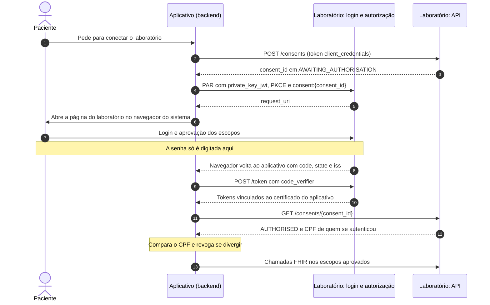

# Open Labs Brasil para equipes de engenharia e de segurança de laboratórios

2026-11-17, especificação 0.2.1. Rótulos como [OFB-CONSENT] remetem a [FONTES.md](FONTES.md).

O Open Labs Brasil é um protocolo para que um aplicativo escolhido pelo paciente acesse, com o consentimento dele, catálogo, unidades, agenda, agendamento e resultados de um laboratório de análises clínicas. No vocabulário do Open Finance Brasil, o laboratório é a transmissora e o aplicativo, a receptora, que cria o consentimento como recurso para o titular autorizar na transmissora [OFB-CONSENT]. O perfil de segurança é o FAPI 2.0 Security Profile [FAPI2-SP], e os dados são recursos FHIR R4.

## O que o laboratório constrói

| Componente | Requisito | No Open Finance Brasil |
| --- | --- | --- |
| Servidor de autorização OAuth 2.0 | PAR, PKCE, `private_key_jwt`, tokens vinculados ao certificado por mTLS. Sem OpenID Connect, objeto de requisição assinado ou cifragem | FAPI 1.0 Advanced, fluxo híbrido, `id_token` cifrado [OFB-FAPI] 1, 5.1 |
| Consentimento | `POST`, `GET` e `DELETE /consents` com token `client_credentials`, 60 minutos para autorizar, cinco estados | Mesmo padrão, três estados [OFB-CONSENT], [OFB-CONSENT-ORIENT] |
| Login e aprovação | No domínio do laboratório, sobre o login que o paciente já usa, e uma página para ver e revogar consentimentos | Jornada por redirecionamento [OFB-CONSENT-ORIENT] |
| API FHIR R4 | Recursos por escopo, nos perfis do guia de implementação | APIs próprias em JSON |
| mTLS | Só certificados de aplicativos ativos no registro de participantes | Diretório central [OFB-DIR] |

| Escopo | Recursos FHIR | Consentimento do paciente |
| --- | --- | --- |
| `catalog.read`, `locations.read`, `schedule.read` | ActivityDefinition, ChargeItemDefinition, Location, HealthcareService, Schedule, Slot | Não, só acordo com o aplicativo |
| `appointment.write` | Appointment com ServiceRequest contido | Sim |
| `results.read` | DiagnosticReport, Observation | Sim |
| `consent.read` | Consent | Sim |

Quem já opera Open Finance reaproveita o modelo, mas não a configuração do servidor de autorização, que é de outra geração do FAPI. Lista completa no [índice](../especificacao/00-indice.md), segurança no [capítulo 7](../especificacao/07-perfil-de-seguranca.md).

## O que fica de fora

- **Senha do paciente.** Não sai do laboratório. O servidor recusa a concessão `password` [FAPI2-SP] 5.3.2.1, e da jornada o aplicativo recebe só um código de autorização.
- **Pagamento.** O agendamento devolve um link para a página de pagamento do próprio laboratório, e nenhum escopo expõe valores.
- **Fora da versão 1.** Coleta domiciliar, webhooks, registro dinâmico de clientes, exames de imagem.
- **CPF antes da aprovação.** O aplicativo não o envia. Depois da aprovação, o laboratório devolve o CPF de quem se autenticou e o aplicativo compara com o do seu usuário, ordem inversa à do Open Finance [OFB-FAPI] 8.1.

## A jornada

Chamadas entre servidores usam mTLS. Erros e revogação estão no [capítulo 2](../especificacao/02-fluxos.md).

## Base legal e controles

Resultado de exame é dado pessoal sensível (art. 5º, II, da LGPD) [LGPD]. O desenho se apoia no art. 11, I, consentimento "de forma específica e destacada, para finalidades específicas": escopos nominais, finalidade mostrada ao paciente, tela própria. O art. 18 garante acesso, portabilidade e revogação, mas a portabilidade depende de regulamentação da ANPD ainda em elaboração [ANPD-AGENDA]. Isto não é parecer jurídico, e cobrar pelo acesso pede um antes, porque o art. 11, § 4º, veda o uso compartilhado de dados de saúde para vantagem econômica, com exceção para a portabilidade solicitada pelo titular.

- **Iniciativa do paciente.** Todo fluxo com dados dele começa no aplicativo dele. Operadoras e outras fontes pagadoras não são receptores elegíveis, regra protegida pela [governança](../GOVERNANCE.md), seção 6.
- **Prazo.** Até 12 meses, sem renovação silenciosa. O Open Finance admite prazo indeterminado [OFB-CONSENT].
- **Revogação pelos dois lados**, como no Open Finance [OFB-CONSENT-ORIENT], [OFB-DC], gratuita (art. 8º, § 5º). A página do laboratório funciona com o aplicativo fora do ar, e a revogação invalida todos os tokens.
- **Registro de participantes.** JSON com assinatura PS256 destacada, verificada pelo laboratório: certificados, chaves, `redirect_uris` e escopos de cada aplicativo, e a declaração de que não é operadora.
- **Certificados.** No piloto, certificado TLS comum conferido por hash. Em produção, ICP-Brasil, como no Open Finance [OFB-DCR] 7.1, [OFB-CERT], com perfil ainda a definir.
- **Limitação conhecida.** Toda a confiança do piloto parte da chave que assina o registro, guardada pelo mantenedor, que também opera um aplicativo. Ela não é revogável por dentro do registro, o que precisa mudar antes de produção.

## O que o laboratório ganha

- Uma especificação no lugar de integrações caso a caso, com requisitos identificados para medir conformidade.
- Agendamentos com os exames discriminados, nos códigos do catálogo do próprio laboratório, para unidade e horário que ele publicou.
- Controle do canal: o laboratório escolhe aplicativos e escopos, autentica o paciente com ao menos o nível do próprio portal, entrega só resultados já liberados nos seus canais e pode revogar por segurança. Preço e contrato ficam fora do protocolo.

## Situação e como avaliar

- **Especificação.** Rascunho, fase de piloto. A 0.2.1 está no ramo principal, e a 0.2.2, que esclarece pontos levantados pelo primeiro cliente receptor, está em revisão. Nada foi testado contra um laboratório real, e versões 0.x podem quebrar a anterior ([CHANGELOG.md](../CHANGELOG.md)).
- **Servidor de exemplo e suíte de conformidade.** Em construção, fora do ramo principal: um laboratório simulado com dados sintéticos e uma suíte que testa os requisitos de provedor do [capítulo 9](../especificacao/09-versionamento-e-conformidade.md) contra qualquer endpoint. Por ora, conformidade é autodeclarada.
- **Retorno.** Issue no repositório, privado durante o piloto. Ajuda saber se a terminação TLS repassa o certificado do cliente à aplicação, se todo paciente tem CPF, se o portal já faz PAR e PKCE e se há LOINC nos resultados. Falhas de segurança vão em privado, a um contato ainda não publicado.
- **Governança.** Hoje decide o mantenedor, a Precisa Saúde. Com dois laboratórios e dois aplicativos ativos e independentes, um comitê assume automaticamente e decide por maioria de cada lado, contada em separado. O controle pode depois passar a uma entidade de padronização, nas condições da seção 7.2 do [GOVERNANCE.md](../GOVERNANCE.md). Implementar não exige licença nem taxa (texto CC BY 4.0, código Apache 2.0).
