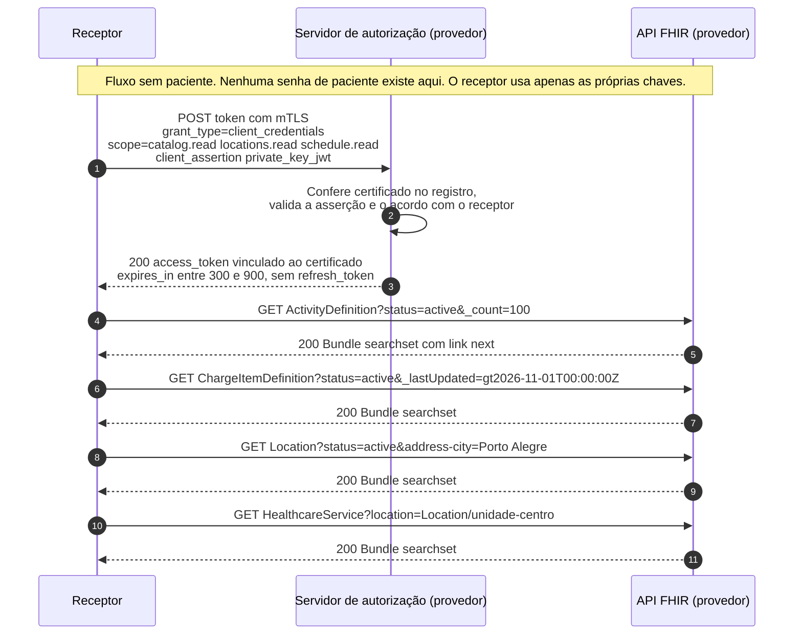
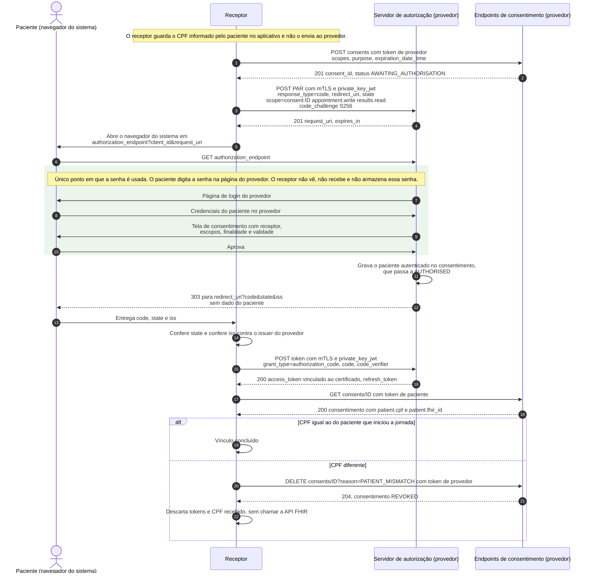
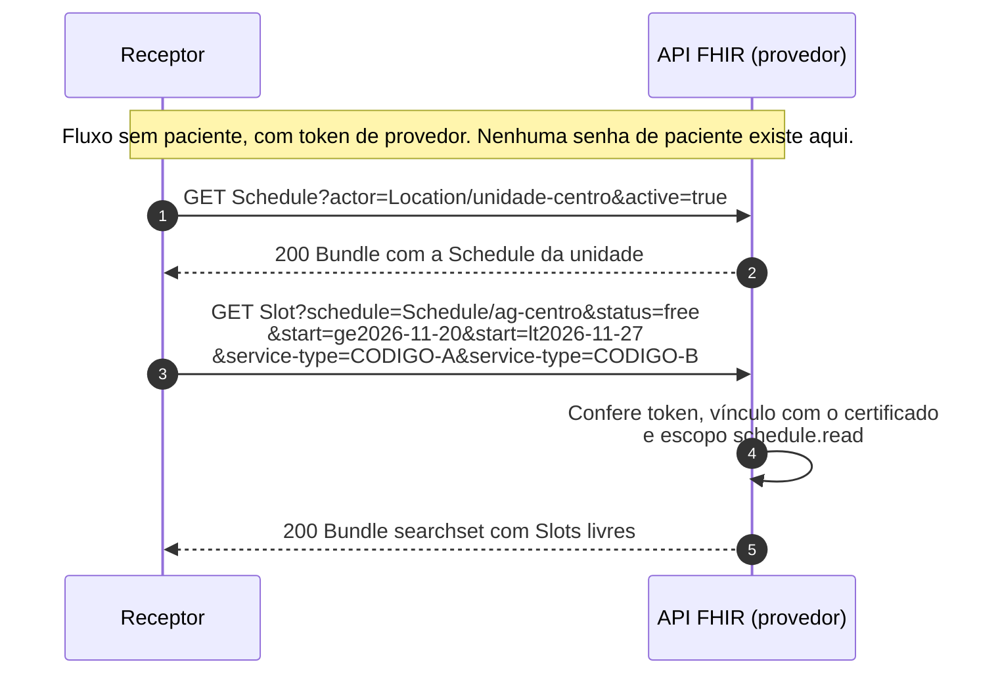
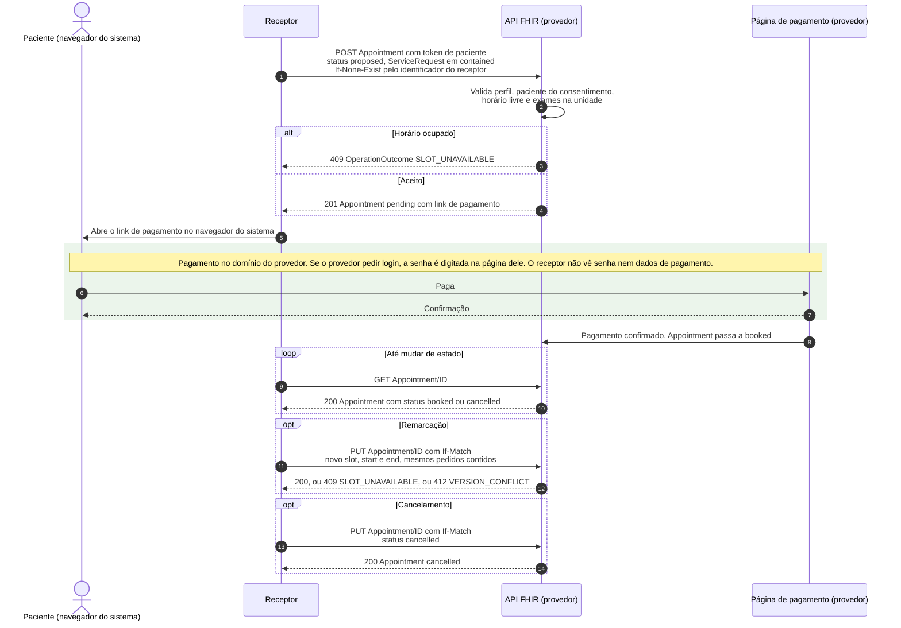
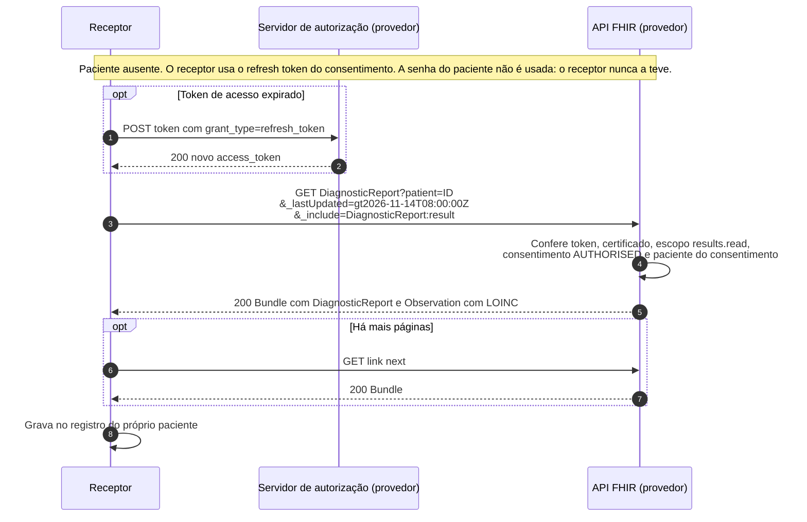
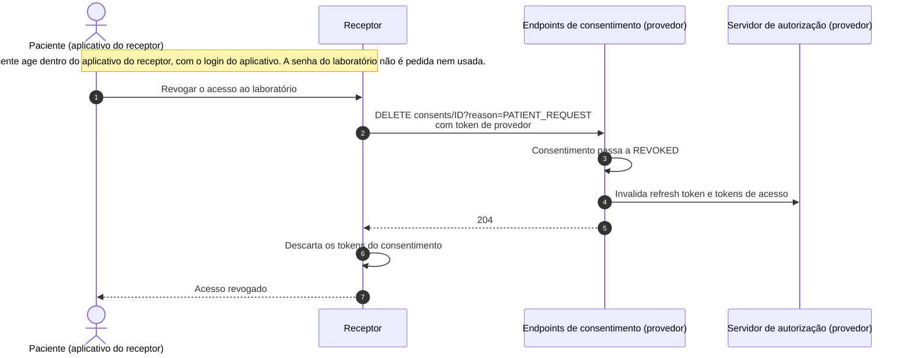
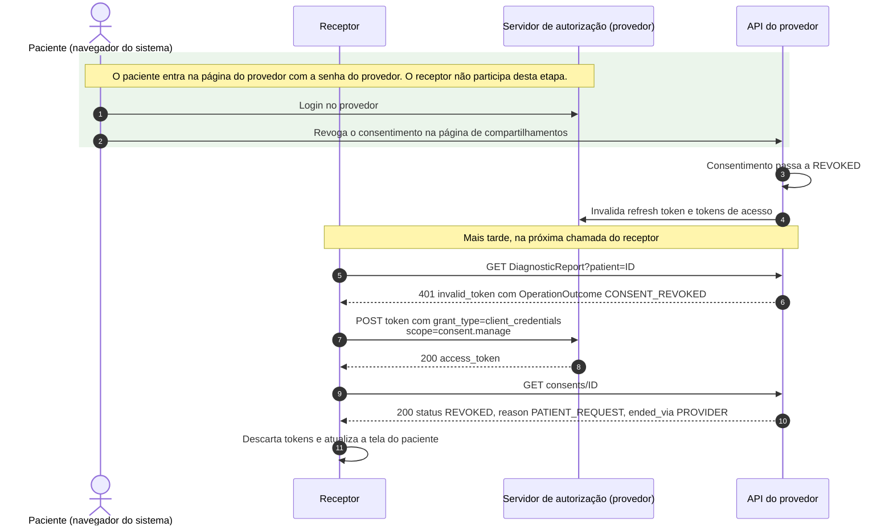
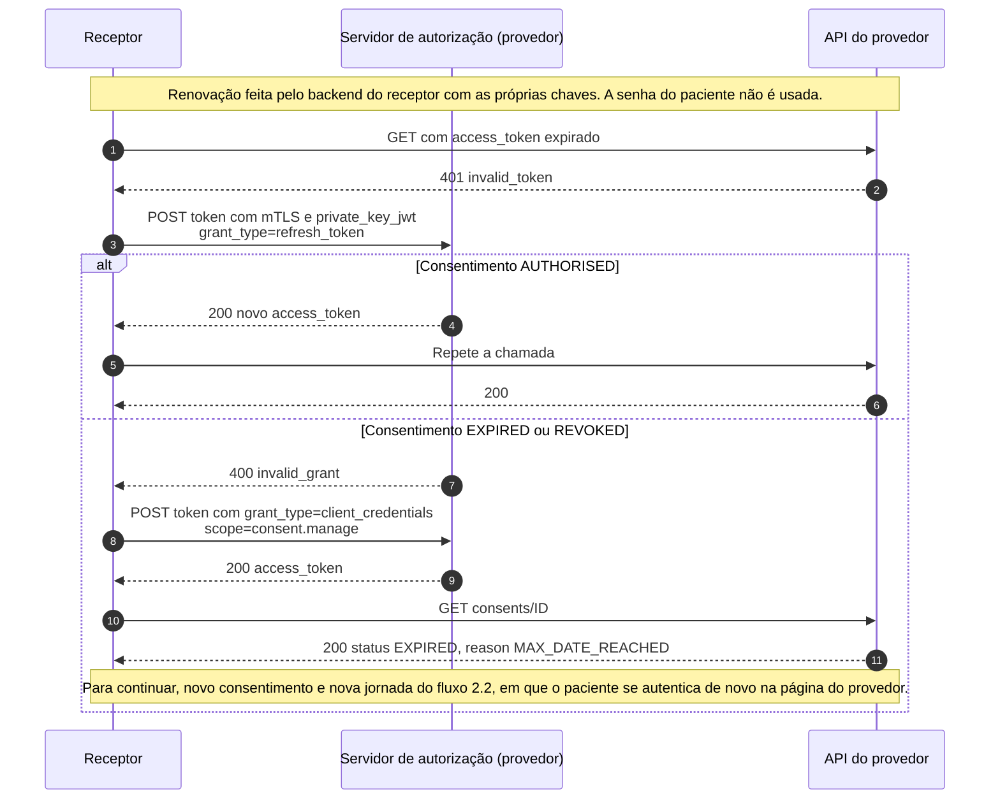

# 2. Fluxos

Cada fluxo abaixo traz as pré-condições, os passos e um diagrama de sequência. Os formatos exatos de requisição e resposta estão em [05-api.md](05-api.md), e os erros em [06-erros.md](06-erros.md).

Em todos os diagramas:

- "Receptor" é o backend do aplicativo, salvo quando o texto diz "aplicativo".
- Toda chamada do receptor a um endpoint que não seja o de autorização usa mTLS com o certificado registrado ([07-perfil-de-seguranca.md](07-perfil-de-seguranca.md), seção 7.5).
- Uma nota indica onde a senha do paciente é usada. Ela só aparece entre o paciente e o provedor de dados.

Os endereços do provedor vêm de duas fontes: o registro de participantes dá `issuer`, `fhir_base_url` e `api_base_url`, e o documento de metadados do servidor de autorização dá os endpoints OAuth. O receptor NÃO DEVE obter esses endereços de outra forma.

| Fluxo | Escopos | Paciente presente |
| --- | --- | --- |
| 2.1 Acesso em nível de provedor | `catalog.read`, `locations.read` | Não |
| 2.2 Criação do consentimento e autorização | `consent.manage`, depois os escopos de paciente | Sim |
| 2.3 Consulta de agenda | `schedule.read` | Não |
| 2.4 Agendamento, remarcação e cancelamento | `appointment.write` | Só no pagamento |
| 2.5 Obtenção de resultados | `results.read` | Não |
| 2.6 Revogação pelo lado do receptor | `consent.manage` | Sim, no aplicativo |
| 2.7 Revogação pelo lado do provedor | (nenhum) | Sim, na página do provedor |
| 2.8 Renovação de token e expiração | (os do consentimento) | Não |

## 2.1 Acesso em nível de provedor (catálogo e unidades)

Usado para `catalog.read`, `locations.read` e `schedule.read` (a agenda tem fluxo próprio em 2.3). Não há paciente nem consentimento: basta o receptor estar ativo no registro e o provedor ter decidido atendê-lo.

**Pré-condições:** receptor e provedor ativos no registro. Acordo entre os dois, quando o provedor exigir.

1. O receptor pede um token ao endpoint de token com `grant_type=client_credentials`, os escopos desejados e a asserção `private_key_jwt`.
2. O servidor de autorização confere o certificado do cliente contra o registro, valida a asserção e verifica se atende aquele receptor.
3. O servidor devolve um token de acesso vinculado ao certificado, com validade de 300 a 900 segundos e sem refresh token.
4. O receptor consulta a API FHIR. A sincronização recomendada é paginada e incremental com `_lastUpdated`.
5. Quando o token expira, o receptor repete o passo 1.

## 2.2 Criação do consentimento e autorização por redirecionamento

É o único fluxo em que o paciente se autentica. Agendamento, resultados e registros de consentimento exigem ter passado por ele. Catálogo, unidades e agenda não exigem.

**Pré-condições:** o paciente escolheu o laboratório dentro do aplicativo. O receptor conhece o CPF desse paciente, informado por ele no aplicativo, e guarda esse CPF junto com a jornada. O receptor tem um token de provedor com o escopo `consent.manage`.

O receptor **não** envia o CPF ao provedor em nenhum passo.

1. O receptor cria o consentimento com `POST {api_base_url}/consents`, informando escopos, finalidade e data de expiração. A resposta traz `consent_id` e o estado `AWAITING_AUTHORISATION`.
2. O receptor gera `state` e o par PKCE (`code_verifier`, `code_challenge` com S256) e envia os parâmetros de autorização ao endpoint PAR, autenticado com `private_key_jwt`. O escopo da requisição é `consent:{consent_id}` mais os escopos do consentimento.
3. O servidor de autorização responde com `request_uri` e `expires_in`.
4. O aplicativo abre o navegador do sistema em `authorization_endpoint?client_id=...&request_uri=...`.
5. O paciente se autentica na página do provedor, com o login que já usa lá. **A senha é digitada na página do provedor e não passa pelo receptor.**
6. O provedor mostra a tela de consentimento: nome do receptor (do registro), escopos em linguagem comum, finalidade, data de expiração. O paciente aprova ou recusa.
7. Aprovado, o provedor grava no consentimento quem é o paciente autenticado, passa o consentimento a `AUTHORISED` e redireciona o navegador para o `redirect_uri` do receptor com `code`, `state` e `iss` na consulta da URL. Nenhum dado do paciente vai no redirecionamento.
8. O aplicativo entrega os três valores ao backend, que confere `state` e confere que `iss` é o `issuer` do provedor para o qual a jornada foi aberta.
9. O backend troca o código por tokens no endpoint de token, com `code_verifier` e `private_key_jwt`. A resposta traz `access_token` e `refresh_token`, e nenhum dado do paciente.
10. **Conferência do titular.** Antes de qualquer outra chamada, o backend lê `GET {api_base_url}/consents/{consent_id}` com o token de paciente. Só nessa leitura a resposta inclui `patient.cpf`, o CPF do paciente que se autenticou no provedor, e `patient.fhir_id`.
11. O backend compara `patient.cpf` com o CPF do paciente que iniciou a jornada no aplicativo.
    - Iguais: o vínculo está concluído.
    - Diferentes: o receptor DEVE revogar o consentimento com `DELETE {api_base_url}/consents/{consent_id}?reason=PATIENT_MISMATCH`, descartar os tokens e o CPF recebido, e não fazer nenhuma chamada à API FHIR com aquele token. O paciente é avisado de que a conta usada no laboratório é de outra pessoa.

A conferência fica com o receptor porque é ele quem sabe em qual registro os dados vão ser gravados. Ela impede que os resultados de quem fez login no laboratório (um familiar no mesmo aparelho, por exemplo) acabem no registro de outro paciente. A razão de o CPF vir pela leitura do consentimento, e não pela resposta do token ou pelo redirecionamento, está em [07-perfil-de-seguranca.md](07-perfil-de-seguranca.md), seção 7.7.

Se o paciente recusar, fechar a página ou não concluir em 60 minutos, o consentimento vai a `REJECTED` e o receptor precisa criar outro. Um `consent_id` serve para uma única jornada de autorização concluída.

## 2.3 Consulta de agenda

Escopo `schedule.read`, com token de provedor. Horário livre de uma unidade não é dado de paciente, então o aplicativo pode mostrar disponibilidade antes de o paciente se conectar ao laboratório.

1. O receptor localiza a agenda da unidade com `GET Schedule?actor=Location/{id}&active=true`.
2. O receptor busca horários livres com `GET Slot?schedule=Schedule/{id}&status=free&start=ge...&start=lt...`, repetindo `service-type` para cada exame da cesta. Parâmetro repetido significa "e" na busca FHIR [FHIR-SEARCH], então o provedor devolve apenas horários em que todos os exames da cesta podem ser coletados.
3. Se algum exame da cesta não é coletado naquela unidade, o provedor devolve um Bundle vazio com um `OperationOutcome` informativo.

A janela entre o primeiro e o último `start` DEVE ter no máximo 31 dias. A consulta cobre atendimento em unidade. Coleta domiciliar está fora da versão 1.

## 2.4 Agendamento, remarcação e cancelamento com link de pagamento

Escopo `appointment.write`, com token de paciente. É neste ponto, e não antes, que o paciente precisa ter se conectado ao laboratório (fluxo 2.2).

**Agendar**

1. O receptor envia `POST Appointment` com um único recurso `Appointment` em estado `proposed`. Os pedidos de exame vão dentro dele, como recursos `ServiceRequest` em `contained`, um por exame, referenciados por `basedOn`. O `Appointment` leva um identificador gerado pelo receptor, repetido no cabeçalho `If-None-Exist` para tornar a criação idempotente.
2. O provedor valida e grava. Como é um recurso só, não há estado intermediário: ou o agendamento existe com todos os pedidos, ou não existe. Se o horário já foi ocupado, responde 409 com `SLOT_UNAVAILABLE`.
3. A resposta 201 traz o `Appointment` como ficou no provedor. Quando há pagamento a fazer, o estado é `pending` e o recurso carrega o link de pagamento. Quando não há, o estado já é `booked`.
4. O aplicativo abre o link de pagamento no navegador do sistema. O paciente paga na página do provedor. **Dados de pagamento e eventual login ficam entre o paciente e o provedor.**
5. O receptor consulta `GET Appointment/{id}` até o estado mudar para `booked`. Se o pagamento não acontece no prazo do provedor, o estado vai a `cancelled`.

**Remarcar**

6. O receptor envia `PUT Appointment/{id}` com `If-Match`, trocando `slot`, `start` e `end` e mantendo os `ServiceRequest` contidos como estavam. O provedor responde 200, ou 409 se o novo horário não está livre, ou 412 se a versão mudou. Trocar os exames não é remarcação: o receptor cancela e cria outro agendamento.

**Cancelar**

7. O receptor envia `PUT Appointment/{id}` com `If-Match` e `status=cancelled`. Depois de cancelado, o agendamento não muda mais.

O provedor PODE recusar remarcação ou cancelamento fora da sua política (por exemplo, a menos de algumas horas do horário) com 422 e `APPOINTMENT_NOT_MODIFIABLE`.

## 2.5 Obtenção de resultados

Escopo `results.read`, com token de paciente. Este fluxo roda normalmente sem o paciente presente: o receptor usa o refresh token para manter o registro do paciente atualizado.

1. Na primeira sincronização, o receptor busca `GET DiagnosticReport?patient={id}&_include=DiagnosticReport:result`, paginando por `link.next`. O `{id}` é o `patient.fhir_id` lido no fluxo 2.2.
2. Nas seguintes, acrescenta `_lastUpdated=gt{instante da última sincronização}`.
3. O provedor devolve apenas laudos do paciente do consentimento, já liberados ao paciente nos canais do próprio provedor, e dentro do período `data_period` do consentimento quando ele existir.
4. O receptor grava os resultados no registro do paciente dentro do aplicativo. Os dados não têm outro destino.

O receptor NÃO DEVERIA consultar resultados do mesmo paciente mais de uma vez a cada 15 minutos. O provedor PODE limitar com 429 e `Retry-After`.

## 2.6 Revogação pelo lado do receptor

O paciente revoga na tela de consentimentos do aplicativo, ou o receptor encerra o vínculo por conta própria (por exemplo, exclusão da conta, ou CPF divergente no fluxo 2.2).

1. O receptor envia `DELETE {api_base_url}/consents/{consent_id}?reason=PATIENT_REQUEST` com um token de provedor (`consent.manage`).
2. O provedor passa o consentimento a `REVOKED` e invalida o refresh token e os tokens de acesso ligados a ele.
3. O receptor descarta os tokens. Chamadas posteriores com eles recebem 401.

O receptor DEVE enviar a revogação ao provedor assim que o paciente a pedir, e DEVE parar de usar os tokens mesmo que a chamada falhe. Se falhar, repete até conseguir.

## 2.7 Revogação pelo lado do provedor

O paciente revoga na página de consentimentos do laboratório (`consent_management_uri` no registro), ou o provedor revoga por motivo de segurança.

1. O paciente se autentica no provedor e revoga. **A senha é usada apenas na página do provedor.**
2. O provedor passa o consentimento a `REVOKED` e invalida os tokens.
3. Não há notificação. O receptor descobre na próxima chamada: 401 com `invalid_token` em um recurso, ou 400 com `invalid_grant` ao renovar o token.
4. Ao receber um desses erros, o receptor consulta `GET {api_base_url}/consents/{consent_id}` com um token de provedor, lê o estado e o motivo, e atualiza o que mostra ao paciente.

Como o receptor pode passar dias sem chamar o provedor, ele DEVE consultar o estado de cada consentimento `AUTHORISED` pelo menos uma vez a cada 24 horas.

## 2.8 Renovação de token e expiração

1. O token de acesso dura de 300 a 900 segundos. Quando expira, o receptor envia `grant_type=refresh_token` ao endpoint de token, com `private_key_jwt` e um certificado registrado.
2. O servidor devolve um novo token de acesso. O refresh token normalmente não muda: o perfil proíbe a rotação, salvo em circunstâncias extraordinárias. Se a resposta trouxer um refresh token diferente, o receptor passa a usar o novo.
3. O refresh token vale enquanto o consentimento estiver `AUTHORISED`.
4. Na data `expiration_date_time`, o provedor passa o consentimento a `EXPIRED` e invalida os tokens. A renovação seguinte recebe `invalid_grant`.
5. Para continuar, o receptor cria um novo consentimento e leva o paciente de novo pela jornada do fluxo 2.2. Não há renovação silenciosa.

O receptor DEVERIA avisar o paciente antes da expiração. O `expiration_date_time` é conhecido desde a criação.

