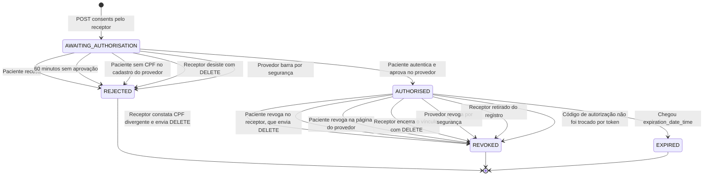

# 4. Ciclo de vida do consentimento

O consentimento é um recurso do provedor de dados. O receptor o cria, o paciente o autoriza na página do provedor, e qualquer um dos lados pode encerrá-lo. Os tokens dependem dele: sem consentimento `AUTHORISED` não há token de paciente válido.

## 4.1 Estados

| Estado | Significado | Final | `Consent.status` no FHIR R4 |
| --- | --- | --- | --- |
| `AWAITING_AUTHORISATION` | Criado pelo receptor. É uma intenção: ainda não dá acesso a nada e ainda não tem paciente | Não | `proposed` |
| `AUTHORISED` | Aprovado pelo paciente no provedor, que gravou quem é o paciente. Tokens de paciente podem ser emitidos e usados | Não | `active` |
| `REJECTED` | Nunca chegou a valer: recusado, expirado antes da aprovação ou barrado | Sim | `rejected` |
| `REVOKED` | Valeu e foi encerrado antes da data de expiração | Sim | `inactive` |
| `EXPIRED` | Valeu até a data de expiração | Sim | `inactive` |

Os códigos da última coluna são os do conjunto `ConsentState` do FHIR R4 [FHIR-CONSENT]. A representação FHIR do consentimento, lida com o escopo `consent.read`, segue o perfil `br-lab-access-consent` do guia de implementação.

## 4.2 Diagrama de estados

## 4.3 Transições

Cada transição grava `status_update_date_time` e, nos estados finais, o objeto `status_reason` com `code` e `ended_via`.

| # | De | Para | Gatilho | `status_reason.code` | `ended_via` |
| --- | --- | --- | --- | --- | --- |
| T1 | (nenhum) | `AWAITING_AUTHORISATION` | `POST /consents` aceito | (ausente) | (ausente) |
| T2 | `AWAITING_AUTHORISATION` | `AUTHORISED` | O paciente se autentica no provedor e aprova na tela de consentimento. O provedor grava o paciente autenticado | (ausente) | (ausente) |
| T3 | `AWAITING_AUTHORISATION` | `REJECTED` | O paciente recusa na tela de consentimento | `PATIENT_REJECTED` | `PROVIDER` |
| T4 | `AWAITING_AUTHORISATION` | `REJECTED` | 60 minutos desde a criação sem aprovação | `AUTHORISATION_TIMEOUT` | `SYSTEM` |
| T5 | `AWAITING_AUTHORISATION` | `REJECTED` | O paciente autenticado não tem CPF no cadastro do provedor | `PATIENT_WITHOUT_CPF` | `SYSTEM` |
| T6 | `AWAITING_AUTHORISATION` | `REJECTED` | `DELETE /consents/{id}` pelo receptor | `RECEIVER_TERMINATION` | `RECEIVER` |
| T7 | `AWAITING_AUTHORISATION` | `REJECTED` | Política de segurança do provedor | `PROVIDER_SECURITY` | `PROVIDER` |
| T8 | `AUTHORISED` | `REVOKED` | `DELETE /consents/{id}?reason=PATIENT_MISMATCH`: o receptor constatou que o CPF devolvido não é o do paciente que iniciou a jornada | `PATIENT_MISMATCH` | `RECEIVER` |
| T9 | `AUTHORISED` | `REVOKED` | `DELETE /consents/{id}?reason=PATIENT_REQUEST` | `PATIENT_REQUEST` | `RECEIVER` |
| T10 | `AUTHORISED` | `REVOKED` | O paciente revoga na página de consentimentos do provedor | `PATIENT_REQUEST` | `PROVIDER` |
| T11 | `AUTHORISED` | `REVOKED` | `DELETE /consents/{id}?reason=RECEIVER_TERMINATION` | `RECEIVER_TERMINATION` | `RECEIVER` |
| T12 | `AUTHORISED` | `REVOKED` | Suspeita de fraude ou outra política de segurança do provedor | `PROVIDER_SECURITY` | `PROVIDER` |
| T13 | `AUTHORISED` | `REVOKED` | O receptor passa a `withdrawn` no registro | `RECEIVER_WITHDRAWN` | `SYSTEM` |
| T14 | `AUTHORISED` | `REVOKED` | O código de autorização expirou sem ser trocado por token | `TECHNICAL_ISSUE` | `SYSTEM` |
| T15 | `AUTHORISED` | `EXPIRED` | O relógio do provedor alcança `expiration_date_time` | `MAX_DATE_REACHED` | `SYSTEM` |

Nenhuma outra transição é permitida. `REJECTED`, `REVOKED` e `EXPIRED` não mudam mais.

## 4.4 Regras

**Criação**

- O provedor DEVE devolver `AWAITING_AUTHORISATION` em toda criação aceita.
- A criação não identifica o paciente. O receptor NÃO DEVE enviar CPF, nome ou qualquer outro identificador do paciente em `POST /consents`, e o provedor DEVE recusar com 400 um corpo que traga campo desconhecido.
- `scopes` DEVE conter apenas escopos de paciente ([03-escopos.md](03-escopos.md), seção 3.2) que o provedor suporta e que o registro permite ao receptor. Caso contrário, 422 com `CONSENT_INVALID_SCOPES`.
- `expiration_date_time` é obrigatório, DEVE estar no futuro e DEVE ficar a no máximo 12 meses da criação. Caso contrário, 422 com `CONSENT_INVALID_EXPIRATION`. Não existe consentimento por prazo indeterminado.
- `purpose` é obrigatório e é mostrado ao paciente, sem alteração, na tela de consentimento.

**Autorização**

- O provedor DEVE aceitar uma requisição de autorização somente se o escopo dinâmico `consent:{consent_id}` apontar para um consentimento em `AWAITING_AUTHORISATION`, criado pelo mesmo `client_id`. Caso contrário, `invalid_request` na resposta do PAR.
- Os escopos pedidos na requisição de autorização DEVEM ser o escopo dinâmico e um subconjunto dos escopos do consentimento. O token emitido carrega no máximo os escopos do consentimento.
- A tela de consentimento DEVE mostrar o nome do receptor como está no registro, cada escopo em linguagem comum, a finalidade e a data de expiração, e DEVE informar que o CPF de quem autoriza será confirmado ao aplicativo. O paciente aprova ou recusa o conjunto inteiro: a versão 1 não tem aprovação parcial de escopos.
- O provedor DEVE autenticar o paciente com nível de garantia ao menos igual ao que exige para o paciente ver resultados no próprio portal.
- Na aprovação, o provedor DEVE gravar no consentimento o paciente autenticado: o CPF do cadastro e o id lógico do recurso Patient. Se o paciente autenticado não tem CPF no cadastro, o provedor DEVE encerrar com `access_denied` e aplicar T5.

**Conferência do titular**

- O provedor DEVE devolver `patient.cpf` e `patient.fhir_id` em `GET /consents/{consent_id}` quando, e somente quando, a chamada usa um token de paciente ligado àquele consentimento.
- O provedor NÃO DEVE devolver o CPF do paciente no redirecionamento de autorização, na resposta do endpoint de token nem em leitura feita com token de provedor.
- O receptor DEVE fazer essa leitura logo depois de receber os tokens e antes de qualquer chamada à API FHIR, e DEVE comparar `patient.cpf` com o CPF do paciente que iniciou a jornada no aplicativo. A comparação é entre os 11 dígitos, sem pontuação.
- Havendo diferença, o receptor DEVE enviar `DELETE /consents/{consent_id}?reason=PATIENT_MISMATCH`, DEVE descartar os tokens e o CPF recebido, e NÃO DEVE ler nem gravar dado de saúde com aquele consentimento.
- O receptor NÃO DEVE usar o CPF recebido para outra finalidade além da comparação.

**Conferência impossível**

A conferência é impossível quando o receptor não consegue um `patient.cpf` utilizável: a leitura do consentimento falha (erro de rede, 429 ou 5xx depois de até três tentativas com recuo, ou 401, 403 ou 404 na primeira resposta), ou responde 200 sem o objeto `patient`, sem `patient.cpf`, ou com um valor que não tem 11 dígitos com dígitos verificadores válidos.

- Nesse caso o receptor NÃO DEVE concluir o vínculo e NÃO DEVE ler nem gravar dado de saúde com aquele consentimento. Um vínculo sem conferência não é aceito em nenhuma circunstância, nem de forma provisória.
- O receptor DEVE descartar os tokens e DEVE revogar o consentimento com `DELETE /consents/{consent_id}?reason=RECEIVER_TERMINATION`.
- O receptor NÃO DEVE usar `reason=PATIENT_MISMATCH` nesse caso. `PATIENT_MISMATCH` afirma que dois CPFs foram comparados e são diferentes, o que não foi observado.
- O paciente é avisado de que a conexão não pôde ser concluída e pode tentar de novo, com um novo consentimento.

**Vigência**

- O servidor de autorização DEVE emitir e aceitar tokens de paciente somente enquanto o consentimento ligado a eles estiver `AUTHORISED`.
- O refresh token DEVE valer até o fim do consentimento e NÃO DEVE sobreviver a ele.
- O provedor DEVE aplicar T15 no instante de `expiration_date_time`, com tolerância de 60 segundos.

**Encerramento**

- Ao entrar em `REVOKED` ou `EXPIRED`, o provedor DEVE invalidar o refresh token e os tokens de acesso ligados ao consentimento. A partir daí, o servidor de recursos responde 401 a qualquer chamada com esses tokens.
- O provedor DEVE oferecer ao paciente uma página (`consent_management_uri` no registro) que lista os consentimentos `AUTHORISED`, com receptor, escopos, finalidade e validade, e permite revogar cada um.
- O receptor DEVE oferecer ao paciente uma tela equivalente e DEVE enviar `DELETE` ao provedor quando o paciente revogar por ali.
- Revogar é gratuito para o paciente nos dois lados.
- `DELETE` em um consentimento que já está em estado final responde 422 com `CONSENT_INVALID_STATE`.

**Revogação pendente**

Vale para toda revogação que o receptor envia: pedida pelo paciente, por encerramento do vínculo, por `PATIENT_MISMATCH` ou por conferência impossível.

1. No momento em que a revogação é decidida, antes de qualquer chamada, o receptor DEVE descartar o token de acesso e o refresh token daquele consentimento e parar de chamar a API FHIR com ele. A partir daí, do ponto de vista do receptor, o acesso acabou.
2. O receptor envia o `DELETE`. Em falha que admite repetição (rede, 429, 5xx, ou falha ao obter o token de provedor), ele faz no máximo **três tentativas automáticas** ao todo, com recuo exponencial e respeitando `Retry-After`.
3. Se as três falham, o receptor DEVE gravar a revogação como **pendente** em armazenamento durável, que sobreviva a reinício do backend, com `consent_id`, provedor, motivo e instante do pedido.
4. Enquanto pendente, o receptor DEVE repetir a tentativa ao menos uma vez por hora nas primeiras 24 horas e ao menos uma vez por dia depois disso. Cada repetição é uma única chamada, sem nova sequência de três.
5. Enquanto pendente, o receptor DEVE mostrar ao paciente, na tela de consentimentos, que o aplicativo já parou de acessar os dados, que a revogação ainda não foi confirmada pelo laboratório, e o endereço da página de consentimentos do provedor (`consent_management_uri`), onde o paciente pode revogar diretamente.
6. A pendência termina quando o `DELETE` responde 204, ou 422 `CONSENT_INVALID_STATE`, ou 404 `CONSENT_NOT_FOUND`, ou quando uma leitura do consentimento mostra estado final, ou quando passa `expiration_date_time`. Nos quatro últimos casos o consentimento já não vale no provedor.
7. O receptor NÃO DEVE apagar uma pendência por desistência nem por limite de tentativas.

A página de consentimentos do provedor é o caminho garantido do paciente: funciona mesmo que o receptor esteja fora do ar, suspenso no registro ou com o registro expirado. Por isso o item 5 é obrigatório.

**Histórico**

- O provedor DEVE guardar o histórico de estados de cada consentimento, com data e motivo de cada transição, para formar trilha de auditoria. O prazo de guarda fica a cargo do provedor e da sua política de retenção.
- `GET /consents/{id}` com token de provedor continua respondendo para consentimentos em estado final por pelo menos 12 meses depois do encerramento.

## 4.5 Diferença em relação ao Open Finance Brasil

A API de consentimentos do Open Finance Brasil tem três estados: `AWAITING_AUTHORISATION`, `AUTHORISED` e `REJECTED`. O `REJECTED` cobre a recusa, o prazo de 60 minutos, a revogação e o vencimento, e o motivo fica em `rejection.reason.code` e `rejectedBy` [OFB-CONSENT], [OFB-CONSENT-ORIENT].

O Open Labs Brasil separa `REVOKED` e `EXPIRED` de `REJECTED` por duas razões. O `ConsentState` do FHIR R4 já distingue `rejected` de `inactive`, e o perfil `br-lab-access-consent` usa os dois. E um paciente que lê "rejeitado" em um consentimento que usou por meses e depois revogou tende a entender errado o que aconteceu. Os gatilhos, o prazo de 60 minutos e a regra de que os estados finais não mudam são os do Open Finance Brasil.

Outras diferenças:

- O Open Finance Brasil admite consentimento por prazo indeterminado e renovação sem redirecionamento [OFB-CONSENT]. O Open Labs Brasil limita o consentimento a 12 meses e não tem renovação silenciosa.
- No Open Finance Brasil a receptora informa o CPF do usuário na criação, e a transmissora recusa a autorização se o usuário autenticado for outro [OFB-FAPI], seção 8.1. Aqui o receptor não informa CPF. O provedor devolve o CPF de quem se autenticou, e o receptor compara. Com isso o laboratório não fica sabendo de um CPF antes de o titular ter aprovado alguma coisa.
